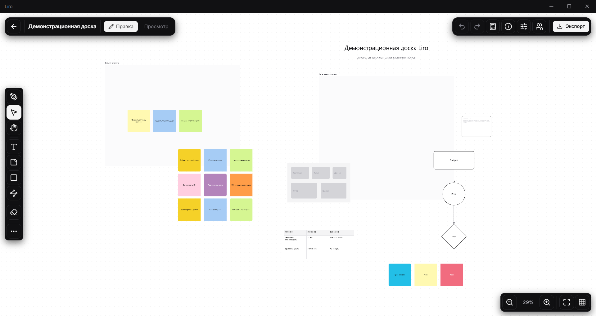
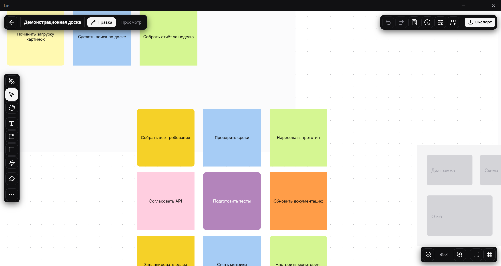
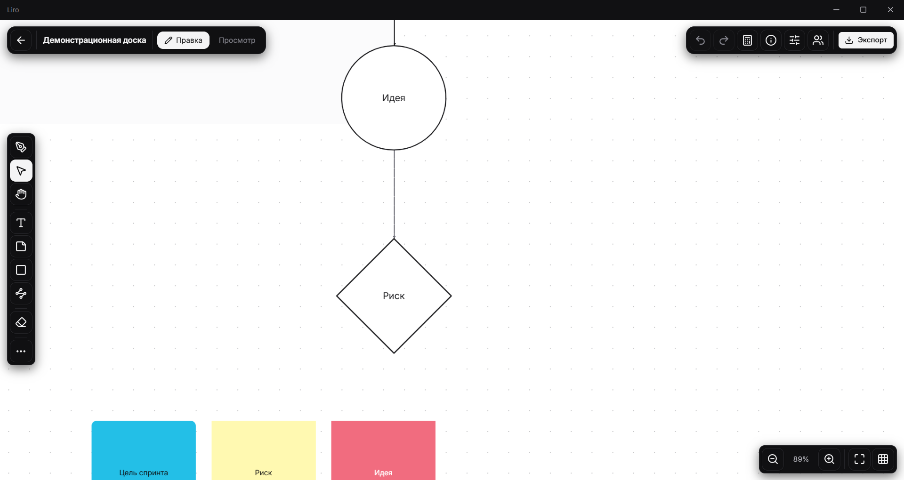

  
  <h1>Liro</h1>
  
Настольная доска для заметок, схем и совместной работы

  

  <a href="https://github.com/LiroOrg/LiroReleases/releases/download/v1.14.23/Liro-1.14.23-x64-setup.exe">Liro-1.14.23-x64-setup.exe</a> · 118 МБ · Windows 10 и 11, 64 бита

  

## Что это

Liro — приложение для Windows: бесконечная белая доска, на которой можно думать вместе.
Доски живут на вашем компьютере, аккаунт не нужен, интернет — только для совместной работы
и для обновлений.

## Доска

- Стикеры, текст, фигуры, трёхмерные фигуры с надписями на гранях, связи между объектами
- Картинки, таблицы, рамки, рисование от руки
- Файл, перетащенный на доску, остаётся на ней: карточка с первой страницей, предпросмотр по двойному щелчку, картинки из документа — прямо на доске
- Группы объектов, слои, поворот, запертые объекты
- Белая доска и сетка, которая вписывается в любое приближение
- Экспорт в LIRO, PNG, HTML и SVG — целиком или по рамке, до 4×

  
  

## Совместная работа

Ссылка на доску — и второй человек уже на ней: видит ваш курсор, рисует, двигает объекты.
Участники видны в списке справа, любой может перенести к себе нужную часть доски.
Связь прямая, между двумя компьютерами: работает в локальной сети и через интернет.

## Библиотека

Доски складываются в проекты, помечаются в избранное и уходят в архив, когда перестают быть
нужны. Ищутся по названию и описанию, сортируются по дате, числу объектов и размеру.
Любую доску можно открыть без интернета и полностью редактировать.

## Установка

Скачайте [`Liro-1.14.23-x64-setup.exe`](https://github.com/LiroOrg/LiroReleases/releases/download/v1.14.23/Liro-1.14.23-x64-setup.exe) и запустите — установщик сам найдёт прежнюю версию и поставит новую поверх, доски останутся на месте.
Нужна Windows 10 или 11, 64 бита.

## Обновления

Liro проверяет новые версии сам и обновляется на месте, без переустановки и без окон
установщика. Когда версия готова, приложение спрашивает — перезапустить сейчас или позже.

## Лицензия

© Liro. Все права защищены.
