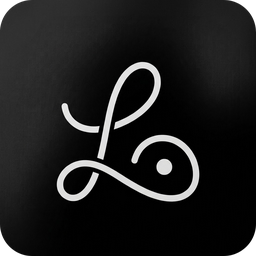
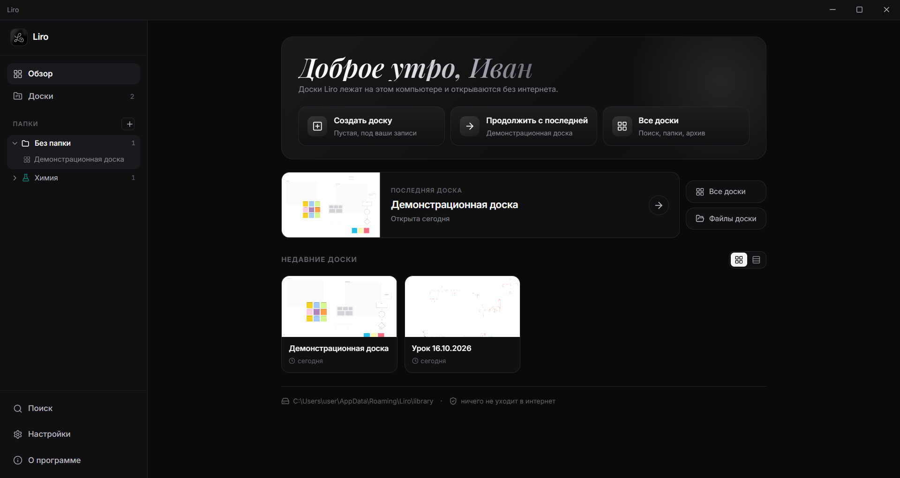
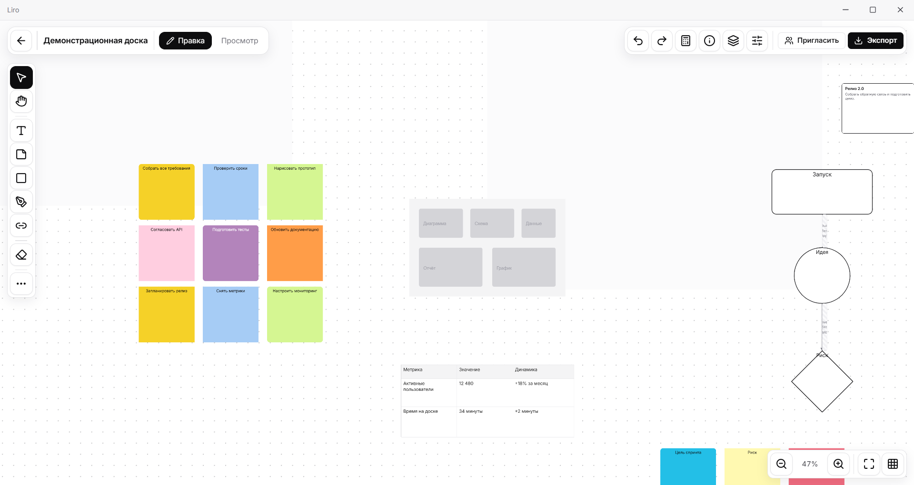

  

<h1 align="center">Liro</h1>

  Настольное приложение для досок. 
  Всё хранится на вашем компьютере, сеть не нужна.

  

  

  

---

## Возможности

| Раздел | Что есть |
| --- | --- |
| **Рисование** | фигуры, линии, стрелки, связи между объектами, текст, стикеры |
| **Картинки** | вставка из файла, из буфера и по ссылке, замена по месту, предпросмотр |
| **3D-фигуры** | куб, пирамида, призма, цилиндр, конус, шар: вращение, перенос, заливка, штрих и текст по граням |
| **Графики** | координатная плоскость с сеткой и осями, кривые по формуле |
| **Таблицы** | настоящие таблицы: правка ячеек, добавление и удаление строк и столбцов |
| **Объекты** | цвет и толщина линии, заливка, шрифт, прозрачность, точные координаты, поворот мышью |
| **Ссылки** | вставка ссылки текстом, клик открывает предпросмотр страницы, PDF, картинки или видео |
| **Работа с доской** | копирование и вставка объектов между досками, группировка, режим докладчика по рамкам |
| **Совместная работа** | второй участник по ссылке, курсор с именем, видно выделение другого, права на правку, перенос другого к себе, пинг |
| **Библиотека** | доски в папках, значки и цвета, поиск, перенос библиотеки целиком |
| **Файлы** | приём доски из буфера, из файла или из архива, сбор доски прямо из браузера, просмотр картинок, PDF и видео |
| **Экспорт** | PNG, PDF, SVG, автономный HTML, ZIP со всеми картинками, JSON |

## Установка

Скачайте **`Liro-1.12.1-x64-setup.exe`** из [релизов](https://github.com/LiroOrg/LiroApp/releases) и запустите.

Установщик на русском языке: мастер, выбор папки, ярлык на рабочем столе,
удаление через «Программы и компоненты».

## Лицензия

Все права защищены. См. [LICENSE](LICENSE).